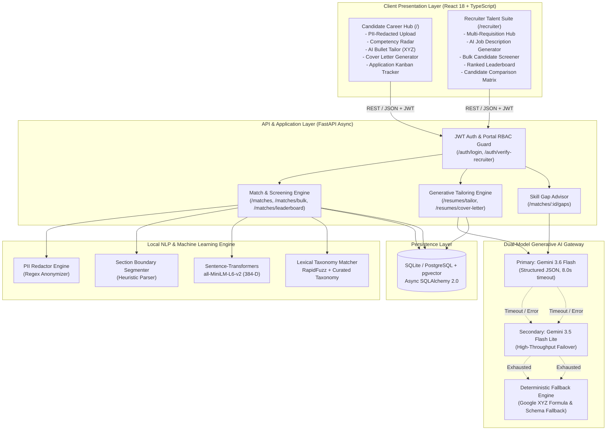
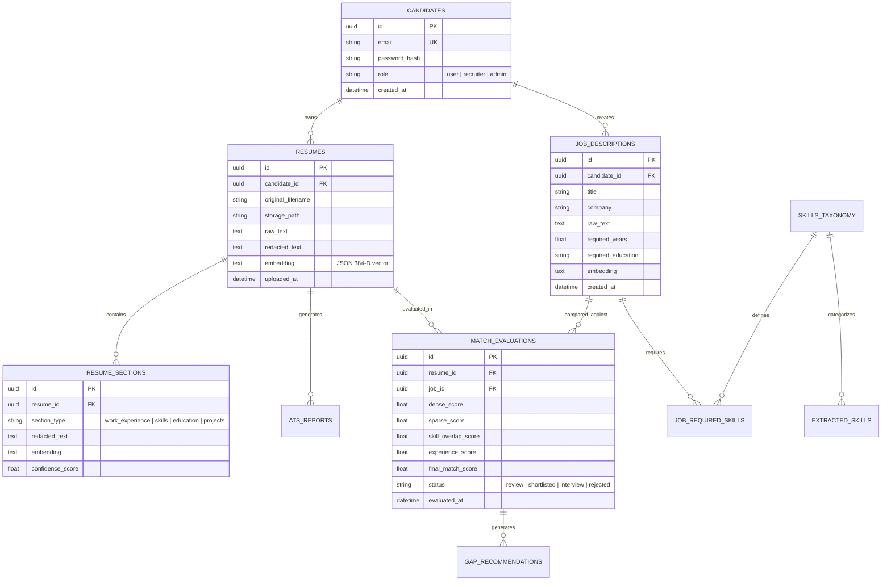

# ResumeLens AI - System Architecture Specification

### UCS503P Software Engineering Capstone Project | Group 3C62
**Thapar Institute of Engineering & Technology (TIET)**

---

## 1. System Overview

ResumeLens AI is a full-stack, distributed career intelligence and recruiter applicant screening system. The platform bridges the divide between candidate resume preparation and enterprise talent screening through automated PII redaction, hybrid vector-lexical compatibility matching, and dual-model generative AI advisory.



---

## 2. Tri-Factor Hybrid Compatibility Algorithm

Traditional applicant tracking systems rely strictly on keyword matching, which penalizes qualified candidates who use synonyms. Conversely, pure semantic dense vector models often experience "hallucinatory relevance" where resumes discussing adjacent fields score artificially high despite lacking mandatory technical competencies.

ResumeLens AI resolves this with a **Tri-Factor Hybrid Scoring Algorithm**:

$$\text{Final Score} = w_1 \cdot S_{\text{semantic}} + w_2 \cdot S_{\text{lexical}} + w_3 \cdot S_{\text{experience}}$$

Where calibrated default weights are:
- $w_1 = 0.40$ (Dense Semantic Vector Fit)
- $w_2 = 0.40$ (Lexical Technical Skill Overlap)
- $w_3 = 0.20$ (Experience & Seniority Fit)

### 2.1 Dense Semantic Vector Fit ($S_{\text{semantic}}$)
- Resumes and Job Descriptions are embedded into 384-dimensional dense vector space using `sentence-transformers/all-MiniLM-L6-v2`.
- Cosine similarity is computed between the global normalized embeddings:
  $$S_{\text{semantic}} = \cos(\mathbf{v}_{\text{resume}}, \mathbf{v}_{\text{job}}) = \frac{\mathbf{v}_{\text{resume}} \cdot \mathbf{v}_{\text{job}}}{\|\mathbf{v}_{\text{resume}}\| \|\mathbf{v}_{\text{job}}\|}$$
- Scores are normalized into $[0.0, 1.0]$.

### 2.2 Lexical Skill Overlap ($S_{\text{lexical}}$)
- Evaluated against a curated taxonomy of 60+ core software engineering technologies across Systems Programming, Web Architecture, Cloud/DevOps, Databases, and Machine Learning.
- Employs token sort ratio fuzzy matching via `RapidFuzz` with an acceptance threshold of $\tau \ge 85\%$.
- Calculated as set-theoretic intersection over job-required skills:
  $$S_{\text{lexical}} = \frac{|\mathcal{S}_{\text{resume}} \cap \mathcal{S}_{\text{job}}|}{|\mathcal{S}_{\text{job}}|}$$

### 2.3 Experience & Seniority Fit ($S_{\text{experience}}$)
- Extracted using regex tenure heuristics and chronological date span analysis.
- Compares detected years of professional experience against job required years:
  $$S_{\text{experience}} = \min\left(1.0, \frac{\text{Years}_{\text{candidate}}}{\text{Years}_{\text{required}}}\right)$$

---

## 3. Dual-Model Generative AI Gateway Architecture

To eliminate reliance on third-party cloud availability and provide sub-second guarantees, the platform uses a tiered fallback architecture:

```
                  +-----------------------------------+
                  |   Resume Tailor / Gap Analysis    |
                  +-----------------+-----------------+
                                    |
                                    v
                  +-----------------------------------+
                  | Primary: Gemini 3.6 Flash         |
                  | Latency Budget: 8.0s              |
                  +-----------------+-----------------+
                                    |
                    +---------------+---------------+
                    | (200 OK)                      | (Timeout / Rate Limit)
                    v                               v
        +-----------------------+       +-----------------------------------+
        | Return Live Synthesis |       | Secondary: Gemini 3.5 Flash Lite  |
        +-----------------------+       | Latency Budget: 10.0s             |
                                        +-----------------+-----------------+
                                                          |
                                          +---------------+---------------+
                                          | (200 OK)                      | (Timeout / Error)
                                          v                               v
                              +-----------------------+       +-----------------------+
                              | Return Lite Synthesis |       | Rule-Based Heuristic  |
                              +-----------------------+       | Fallback (Google XYZ) |
                                                              +-----------------------+
```

### Fallback Guarantee
If external cloud network access is completely offline, the system falls back to a deterministic Google XYZ optimization engine (`Accomplished [X] as measured by [Y] by doing [Z]`), ensuring zero blank screens, zero 500 errors, and zero interruptions during high-stakes demonstrations.

---

## 4. Database Schema & Entity Relationships



---

## 5. Security & Portal Isolation Architecture

### 5.1 Role-Based Access Control (RBAC)
1. **Candidate Boundary (`role: 'user'`)**:
   - Strictly scoped to accessing only self-uploaded resumes (`Resume.candidate_id == current_user.id`).
   - Blocked from viewing recruiter bulk applicant rankings or modifying requisition pipeline statuses.
2. **Recruiter Boundary (`role: 'recruiter'`)**:
   - Enforced by FastAPI's `require_recruiter` dependency.
   - Authorized to create enterprise job requisitions, trigger bulk applicant screenings, update candidate recruitment stages, and export full applicant rosters.
3. **Enterprise Access Verification**:
   - Access to recruiter elevation is protected by cryptographic pre-shared verification keys (`RECRUITER2026`, `TIET-HR-2026`).

### 5.2 Privacy-First PII Redaction
Before any resume content is stored, embedded, or transmitted to LLM inference providers, the PII sanitization pipeline applies strict regex masking:
- Phone numbers: `\b(?:\+?\d{1,3}[-.\s]?)?\(?\d{3}\)?[-.\s]?\d{3}[-.\s]?\d{4}\b` $\rightarrow$ `[PHONE_REDACTED]`
- Email addresses: `\b[A-Za-z0-9._%+-]+@[A-Za-z0-9.-]+\.[A-Z|a-z]{2,}\b` $\rightarrow$ `[EMAIL_REDACTED]`
- Physical street addresses: Detected postal codes and geographic identifiers $\rightarrow$ `[ADDRESS_REDACTED]`
